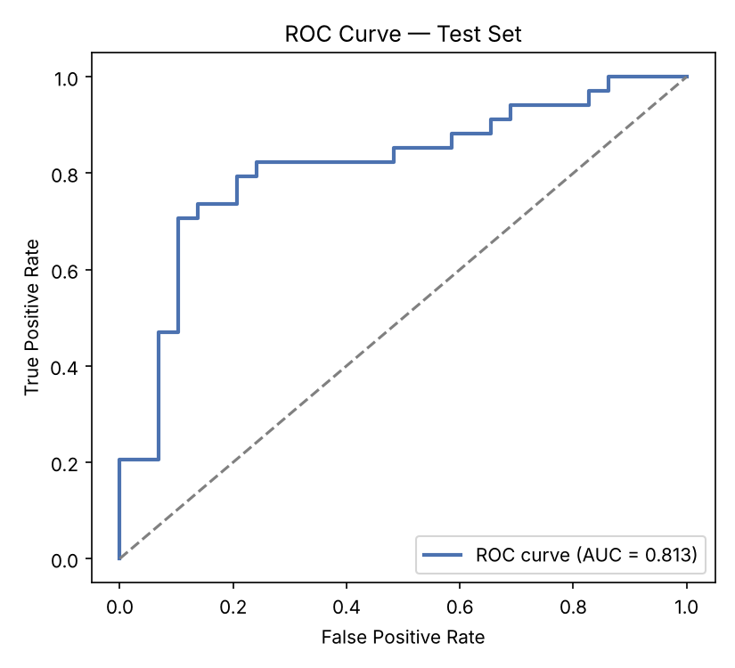
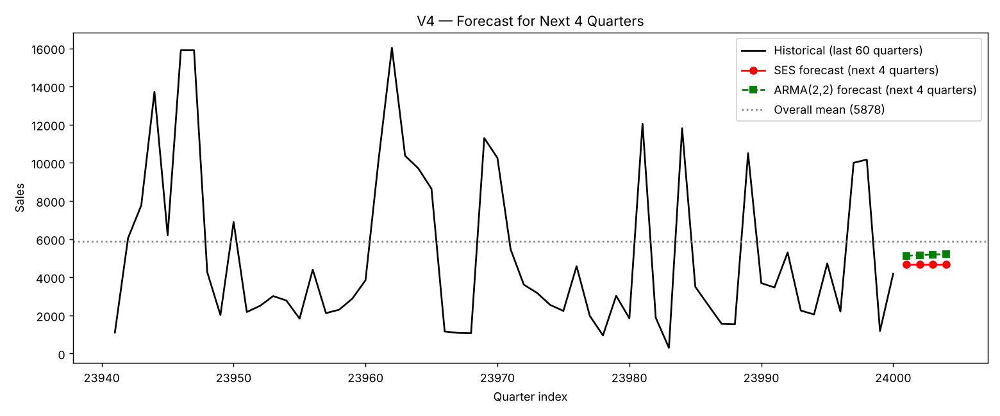
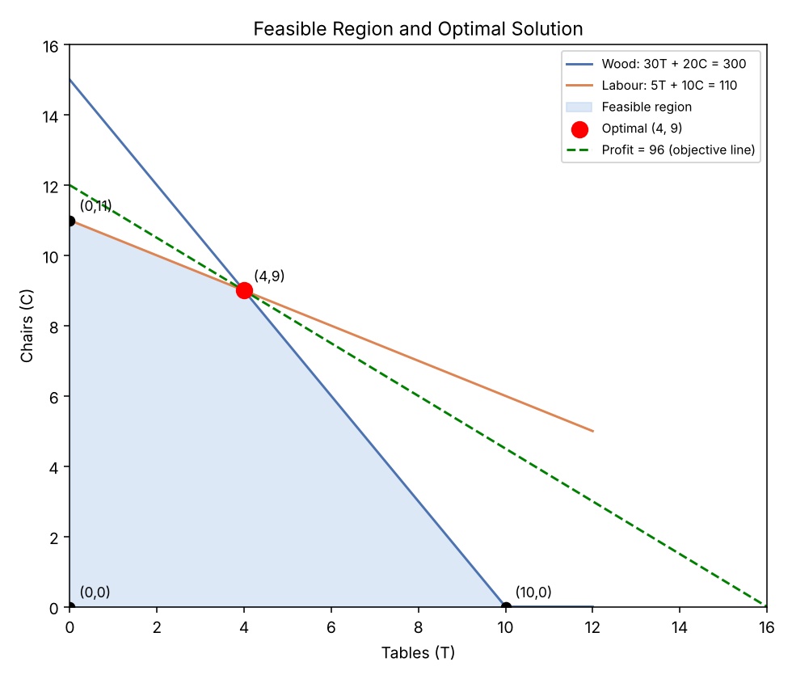

# Statistical Modelling: Logistic Regression, Time Series Forecasting and Integer Optimisation

Three self-contained analyses from my MSc in Data Analytics (National College of Ireland), written in Python.

| Part | Problem | Methods | Headline result |
|------|---------|---------|-----------------|
| 1 | Classify an animal as Mouse or Raccoon from 60 measurements | Logistic regression (statsmodels), Wald tests, odds ratios, Hosmer-Lemeshow, ROC | Test AUC 0.813, accuracy 79.4% |
| 2 | Forecast the next 4 quarters of a sales series (n = 24,000) | ADF, ACF/PACF, SES, AR/ARMA, Ljung-Box, hold-out comparison | SES gave the lowest MAE and RMSE on the hold-out |
| 3 | Maximise profit for a furniture maker | Integer linear programming (PuLP) | 4 tables + 9 chairs, profit 96 |

## Part 1: Logistic regression (`logistic_regression.py`)

- 208 observations, no missing values or duplicates, classes close to balanced (111 Mouse, 97 Raccoon).
- 12 of the 60 predictors were used (`V1, V2, V5, V11, V12, V27, V28, V37, V48, V50, V52, V60`). 70/30 stratified split (145 train, 63 test), `random_state=42`.
- Model fit: omnibus likelihood-ratio chi-square 71.19 (df = 12, p < 0.001), Cox & Snell R² 0.388, Nagelkerke R² 0.518, Hosmer-Lemeshow p = 0.940 (no evidence of poor calibration).
- Test set (cut-off 0.5): accuracy 0.794, precision 0.818, recall 0.794, specificity 0.793, F1 0.806, AUC 0.813. Confusion matrix: 23 / 6 / 7 / 27.
- Only `V37` and `V48` are significant at the 5% level (Wald test); `V1` and `V52` are borderline (p about 0.09 and 0.07). With 12 predictors and 145 training rows, several coefficients have very wide confidence intervals.
- The script also scores a new animal; it comes out at P(Mouse) = 0.114, so Raccoon.



## Part 2: Time series (`time_series_analysis.py`)

- Series `V4`, 24,000 periods, right-skewed (skewness 1.35, excess kurtosis 3.14).
- ADF test rejects a unit root (statistic -15.55, p < 0.001), so the series was treated as stationary and modelled with d = 0.
- ACF and PACF are small but positive and decay slowly (lag-1 autocorrelation 0.17).
- Last 20 periods held out. Out-of-sample results:

| Model | MAE | RMSE |
|-------|-----|------|
| **SES** (alpha 0.063) | **3082** | **3775** |
| SMA(3) | 3127 | 4697 |
| Naive | 3177 | 4754 |
| ARMA(1,1) | 3239 | 3808 |
| ARMA(2,1) | 3264 | 3812 |
| ARMA(2,2) | 3331 | 3845 |
| Mean | 3649 | 3938 |
| AR(1) | 3677 | 3988 |

- 4-period forecast: SES gives a flat 4,680; ARMA(2,2) gives 5,128 rising to 5,210.



## Part 3: Optimisation (`optimisation.py`)

Maximise `6T + 8C` subject to wood `30T + 20C <= 300`, labour `5T + 10C <= 110`, with T and C non-negative integers. CBC solves it to **T = 4, C = 9, profit = 96**, using all the wood (300) and all the labour (110).



## Limitations

- **The ranking of models depends on the metric.** SES wins on MAE and RMSE, but the naive and SMA(3) forecasts have a lower MAPE, and the hold-out is only 20 points from a very noisy series. SES also reported a convergence warning, though alpha is stable across the two fits.
- **No time-series model is adequate.** The Ljung-Box test rejects white-noise residuals for every ARMA model (p between 0.0000 and 0.009), so autocorrelation remains. The ACF is small, so forecasts add little over the long-run mean of about 5,900.
- **Predictor selection (Part 1)** was done before this script runs and is not part of it. If it used the full data, the test metrics are optimistic. The test set has 63 rows, so the AUC has a wide confidence interval.
- The 0.5 cut-off was not tuned.

## Run it

```bash
pip install -r requirements.txt
# put the two CSV files in data/ (see data/README.md)
python logistic_regression.py
python time_series_analysis.py
python optimisation.py
```

Figures are written to `results/`. Console output from my run is saved there as `*_output.txt`. The time-series script takes a few minutes because it fits ARMA models on 24,000 observations.

Tested with Python 3.13, statsmodels 0.14.4, PuLP 2.9.0.
